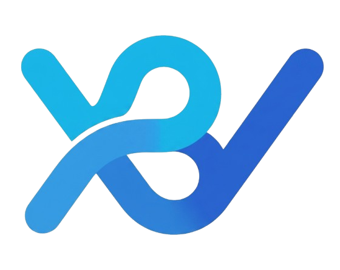
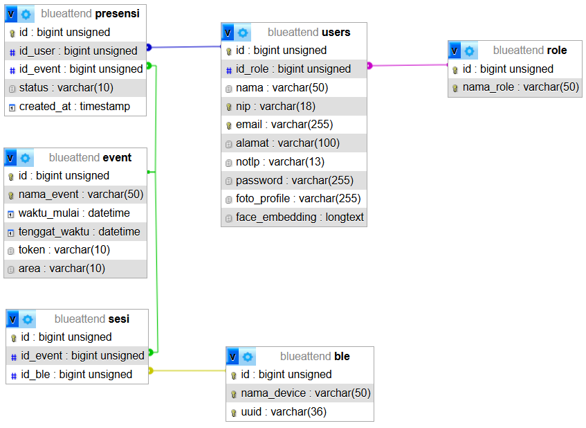

  

# 🖥️ Blueattend - Website & RESTful API Backend

> **BlueAttend** adalah sistem presensi olahraga pegawai berbasis *Bluetooth Low Energy (BLE)* yang terdiri dari **Backend API, aplikasi Mobile Client, dan Web Dashboard**. Backend dibangun menggunakan Laravel sebagai *core engine* berbasis RESTful API untuk memproses, memvalidasi, dan menyediakan layanan data bagi aplikasi mobile dan web. Aplikasi Mobile Client dikembangkan menggunakan Flutter untuk melakukan proses presensi melalui BLE, sedangkan Web Dashboard digunakan untuk mengelola dan memantau data presensi secara terpusat.

---

## 🛠️ Tech Stack & Arsitektur

- **Backend Framework:** Laravel 12 (PHP 8.3+)
- **Web Frontend:** Vue.js 3
- **Mobile Client:** Flutter
- **Database:** MySQL
- **Authentication:** JWT (JSON Web Token) via `tymon/jwt-auth`
- **API Architecture:** RESTful API
- **Backend Architecture:** MVC (Model-View-Controller)
- **Web Build Tool:** Vite
- **Communication:** REST API antara Web/Mobile Client dan Backend
- **Hardware Communication:** Bluetooth Low Energy (BLE)

---

## ✨ Fitur & Kapabilitas Backend

- 🔐 **Stateless JWT Authentication:** Menggunakan *JSON Web Token* untuk mengamankan komunikasi data antara aplikasi mobile, website dan server tanpa membebani session server (stateless).

---

## 🗺️ Relasi Antar Tabel (RAT)

Berikut adalah relasi antar tabel yang digunakan pada sistem Blueattend:

  

---
